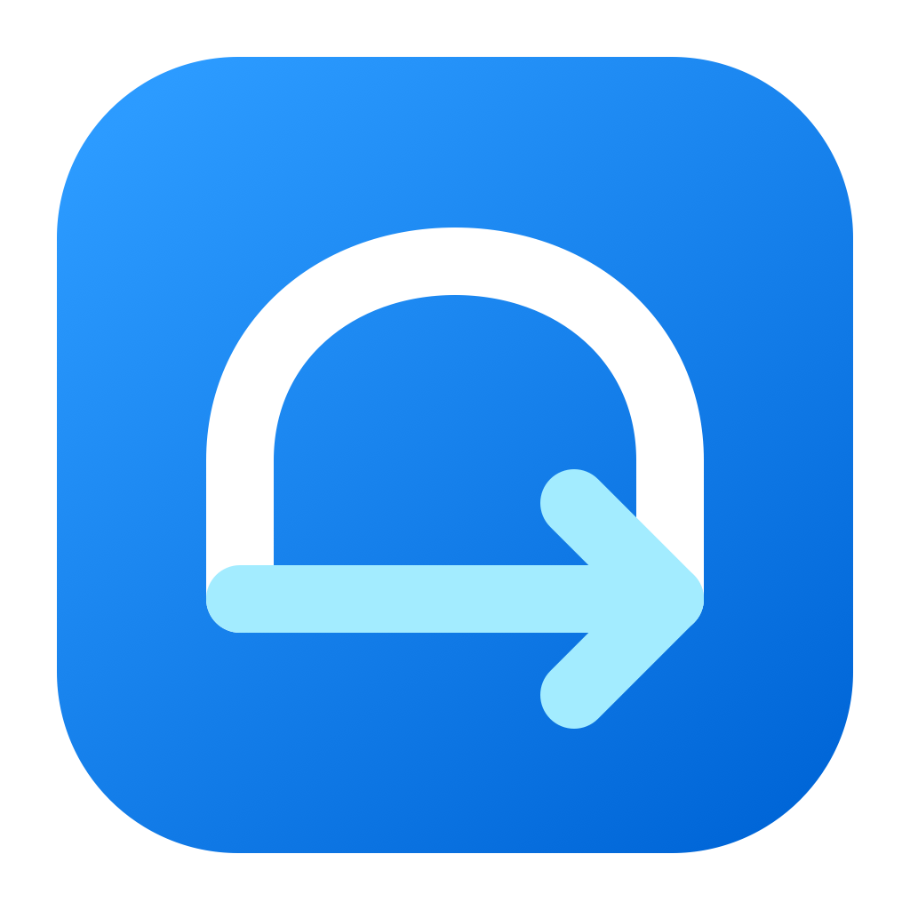
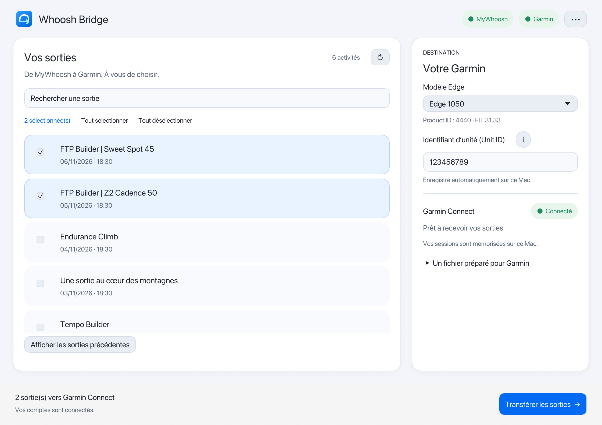
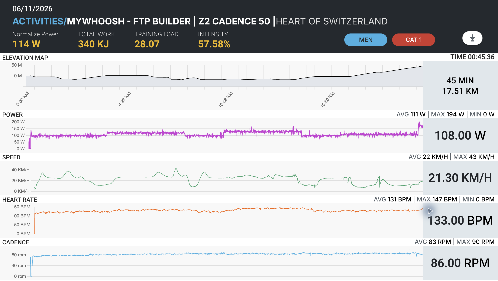
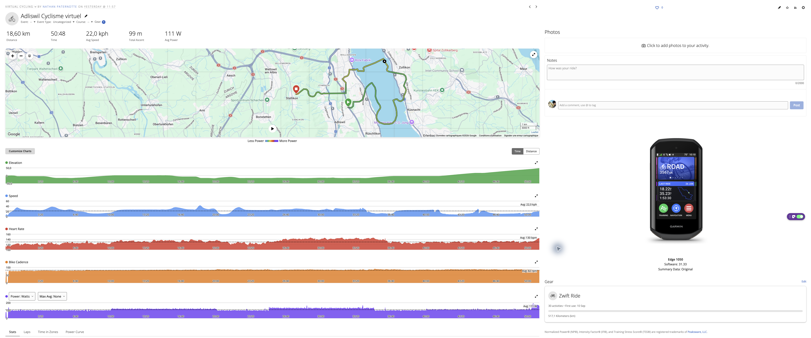
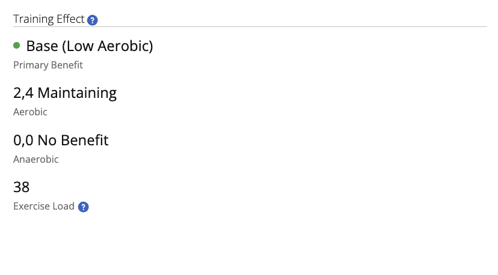

<p align="center"></p>
<h1 align="center">Whoosh Bridge</h1>
<p align="center">Vos sorties MyWhoosh. Votre appareil Garmin.</p>
<p align="center"><a href="README.md">English</a> · Français</p>

Application macOS permettant de choisir ses sorties MyWhoosh, de préparer leurs fichiers FIT avec une identité Garmin Edge cohérente, puis de les transférer vers Garmin Connect.



## Fonctionnalités

- Connexion au site officiel MyWhoosh, sélection des sorties et transfert vers Garmin Connect.
- Sélecteur de 13 modèles Edge avec **Product ID automatique** et versions logicielles publiées par Garmin.
- **Unit ID personnel obligatoire**, mémorisé par modèle sur ce Mac.
- Sessions conservées entre les ouvertures ; une panne réseau ne supprime pas la connexion enregistrée.
- Identifiants MyWhoosh mémorisables dans le trousseau pour préremplir le site officiel. Le CAPTCHA et les choix de consentement restent manuels.
- Mesures et accessoires conservés, moyennes manquantes complétées et températures virtuelles retirées.
- Distinction entre import confirmé, doublon et fichier reçu en attente de traitement.
- Interface en **français et anglais**, sélectionnable dans le menu **•••**.

## Avant / après : MyWhoosh → Garmin Connect

### Avant — la sortie dans MyWhoosh

La page de l’activité MyWhoosh présente la puissance, la fréquence cardiaque, la cadence et le profil du parcours enregistrés pendant la sortie.



### Après — l’Edge choisi apparaît dans Garmin Connect

Après le transfert avec Whoosh Bridge, Garmin Connect affiche l’activité avec l’appareil Garmin sélectionné. Dans cet exemple, l’**Edge 1050** apparaît à droite de la page, à côté de la carte et des graphiques de la sortie.



### Training Effect — un résultat observé

La capture Garmin Connect fournie montre un **Training Effect aérobie de 2,4**, un **Training Effect anaérobie de 0,0** et une **charge d’exercice de 38**, avec **Base (aérobie faible)** comme bénéfice principal.



**Il s’agit d’un résultat observé, pas d’une garantie pour chaque import.** L’import et l’affichage d’un appareil Garmin ne garantissent pas le calcul du Training Effect, de la charge, du statut d’entraînement ou de la VO₂max. L’application n’invente pas ces valeurs ; leur disponibilité dépend du traitement Garmin et des données de l’activité. La version logicielle inscrite dans le FIT est une métadonnée déclarée, pas une lecture du firmware installé sur votre compteur.

## Avertissement sur le développement

Whoosh Bridge a été **vibe codé** : son application de bureau a été développée de manière itérative avec une assistance importante de l’IA. Des tests automatisés et des vérifications locales ont été réalisés, mais ils ne constituent pas un audit de sécurité complet et ne garantissent pas la compatibilité avec les futures évolutions de Garmin ou MyWhoosh. Utilisez l’application à vos propres risques, conservez vos fichiers d’activité originaux et vérifiez les résultats dans Garmin Connect. Le recalcul des métriques d’entraînement après import n’est pas garanti.

## Construire et lancer

Prérequis : macOS 14+, Rust 1.88 ou plus récent (version stable actuelle recommandée), outils de ligne de commande Xcode et Python 3.11+ (3.12 recommandé).

```bash
WHOOSH_PYTHON="$(command -v python3.12)" bash desktop/scripts/build-macos.sh
open "desktop/target/macos/Whoosh Bridge.app"
```

Le paquet inclut le composant Python nécessaire à Garmin. Il est construit pour l’architecture du Mac et signé localement, sans signature Developer ID ni notarisation Apple.

## Vérification et distribution

Les vérifications nécessitent aussi Node.js (version 22 utilisée en CI) et les
composants Rust `rustfmt` et `clippy`.

```bash
rustup component add rustfmt clippy
python3.12 -m venv venv
venv/bin/python -m pip install -r desktop/requirements-test.txt
bash scripts/check.sh
# Après construction de l’app :
bash scripts/package-app.sh
python3 scripts/prepare-source.py
```

Les archives sont créées dans `dist/`. Le ZIP
`Whoosh-Bridge-<version>-macos-<arch>.zip` contient l’app prête à utiliser et doit
être joint à la release GitHub ; son empreinte `.sha256` est également créée.
L’archive `Whoosh-Bridge-source.zip` contient le code. L’export ne nécessite pas Git.

Le projet est centré sur `desktop/` : application Rust, composant Garmin Python,
ressources et tests. L’ancien CLI Python, ses services inutilisés et ses tests ont
été retirés. Les crédits et la licence GPL v3 sont conservés.

## Utilisation

1. Connectez vos comptes MyWhoosh et Garmin. Validez le code Garmin si demandé.
2. Choisissez votre Edge et saisissez son Unit ID. Le bouton **i** explique où le trouver. Le Product ID du modèle est rempli automatiquement.
3. Sélectionnez les sorties et confirmez le transfert.
4. Vérifiez Garmin Connect. Si le fichier est seulement « reçu », attendez son traitement avant de réessayer.

Vos originaux MyWhoosh ne sont pas modifiés. Les activités déjà présentes sur Garmin ne sont ni réécrites ni supprimées.

## Données enregistrées

**Whoosh Bridge ne collecte pas vos identifiants de connexion et ne les envoie ni à son développeur ni à un serveur intermédiaire.** Les jetons de session Garmin et les identifiants MyWhoosh optionnels sont enregistrés localement dans le trousseau de votre Mac (Keychain). Les identifiants et jetons servent à vous authentifier directement auprès de Garmin et MyWhoosh : ils sont nécessairement transmis au service concerné lors de la connexion ou des requêtes authentifiées.

Votre mot de passe Garmin n’est pas enregistré par l’application ; seuls les jetons de session sont conservés dans le trousseau.

Les jetons Garmin et les identifiants MyWhoosh optionnels sont conservés dans le trousseau macOS. Les Unit ID, le modèle et la langue sont enregistrés dans un fichier local privé : `~/Library/Application Support/Whoosh Bridge/preferences.json`. Les anciens réglages sont repris du trousseau une seule fois ; leur ancienne entrée est conservée pour les versions précédentes. MyWhoosh utilise aussi un stockage WebKit persistant. Déconnecter les comptes efface les sessions et identifiants de connexion, mais conserve les réglages des appareils. Effacer le champ Unit ID oublie la valeur de ce modèle.

Si macOS demande un accès au trousseau, **Toujours autoriser** mémorise l’autorisation pour cette identité de l’app ; **Autoriser** ne vaut que pour cet accès. La signature locale actuelle change après reconstruction du binaire et peut entraîner une nouvelle demande. Une signature Developer ID stable est nécessaire pour conserver une identité fiable entre les versions. Les identifiants MyWhoosh ne sont lus que lorsqu’une reconnexion au site est nécessaire.

L’application ne lit pas d’identifiants dans un fichier `.env`. Les fichiers FIT temporaires sont nettoyés après traitement ; les journaux de diagnostic ne contiennent pas les mots de passe ou jetons.

Voir le [README anglais](README.md) pour la liste complète des Edge et versions déclarées, et la [documentation technique](desktop/README.md) pour le développement et les tests.

## Origines et crédits

- [marcelorodrigo/mywhoosh-to-garmin](https://github.com/marcelorodrigo/mywhoosh-to-garmin) : dépôt Python et architecture à l’origine du projet. L’ancien CLI a été retiré.
- [jdelrue/mywoosh2garmin](https://github.com/jdelrue/mywoosh2garmin) : référence pour réparer les moyennes FIT, retirer les températures virtuelles et normaliser l’identité de l’appareil. Son identité Fenix et son numéro fixe ne sont pas repris.
- [cyberjunky/python-garminconnect](https://github.com/cyberjunky/python-garminconnect) et [matin/garth](https://github.com/matin/garth) : intégration et authentification Garmin.
- [garmin/fit-python-sdk](https://github.com/garmin/fit-python-sdk) : profil FIT officiel utilisé pour vérifier les identifiants et les champs.
- [egui](https://github.com/emilk/egui), [Wry](https://github.com/tauri-apps/wry) et [Tao](https://github.com/tauri-apps/tao) : interface Rust et fenêtre web native.

Le logo vectoriel est une création originale de ce projet. La licence **GPL v3** du dépôt est conservée : [LICENSE](LICENSE). Détails : [THIRD_PARTY_NOTICES.md](THIRD_PARTY_NOTICES.md).

Projet indépendant, non affilié à Garmin ou MyWhoosh.
