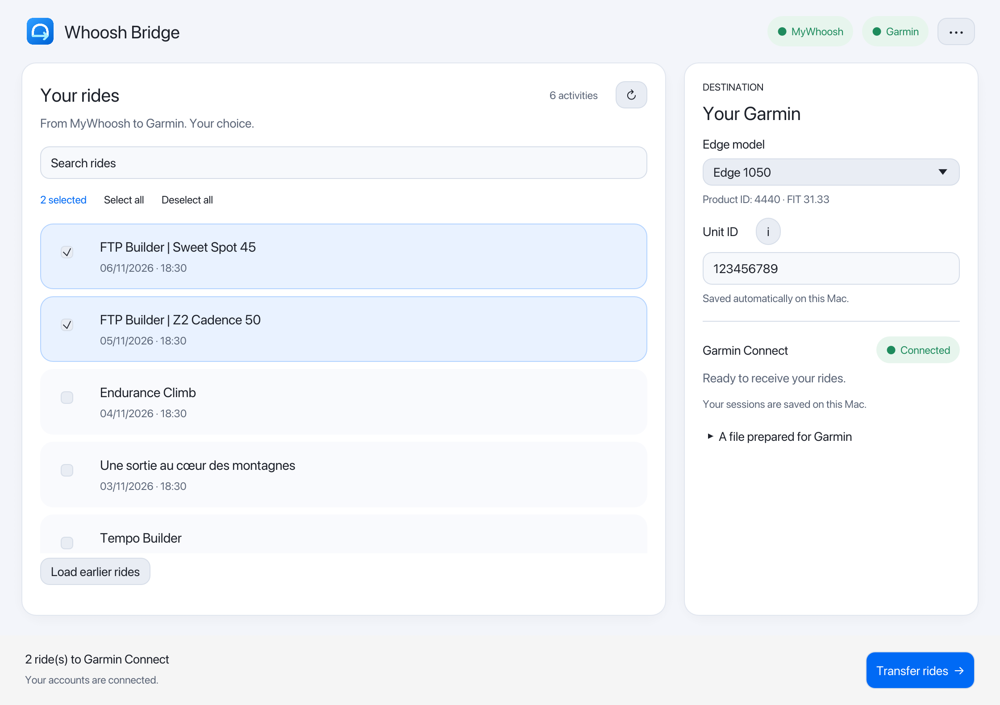
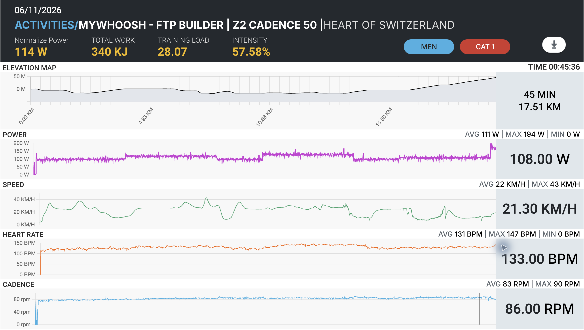
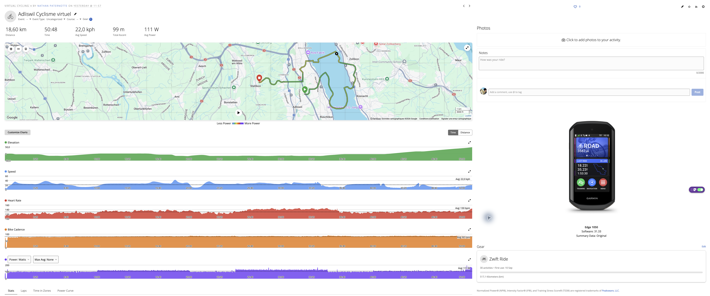
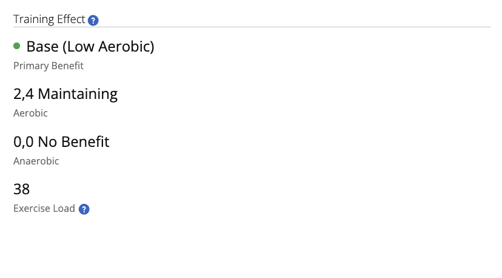

<p align="center"></p>
<h1 align="center">Whoosh Bridge</h1>
<p align="center">Your MyWhoosh rides. Your Garmin device.</p>
<p align="center">English · <a href="README.fr.md">Français</a></p>

A macOS app that lets you select MyWhoosh cycling activities, prepare their FIT files with a consistent Garmin Edge identity, and upload them to Garmin Connect.



## What it does

- Browse and select your MyWhoosh rides through the official MyWhoosh website sign-in flow.
- Choose one of 13 verified Edge profiles. The Product ID is set automatically.
- Associate your personal **Unit ID**, remembered separately for each model on this Mac.
- Keep Garmin sessions in Keychain and MyWhoosh sessions in a persistent WebKit store. Reauthentication is requested when the session is missing or rejected, not on every launch.
- Optionally store your MyWhoosh email/password in Keychain to prefill the official login window. CAPTCHA and consent remain under your control.
- Preserve recorded measurements and accessory identities, repair missing averages, remove virtual temperatures, and normalize recorder metadata.
- Distinguish confirmed imports, duplicate activities, and files received by Garmin but still awaiting processing.
- Switch between **English and French** in the **•••** menu. The language choice is remembered.

## Before and after: MyWhoosh → Garmin Connect

### Before — the ride in MyWhoosh

The MyWhoosh activity page shows the ride’s recorded power, heart rate, cadence and route profile.



### After — the selected Edge appears in Garmin Connect

After transfer with Whoosh Bridge, Garmin Connect displays the activity with the selected Garmin device. In this example, the **Edge 1050** appears on the right of the activity page, alongside the map and recorded charts.



### Training Effect — an observed result

The supplied Garmin Connect capture shows **2.4 aerobic Training Effect**, **0.0 anaerobic Training Effect** and an **exercise load of 38**, with **Base (Low Aerobic)** as the primary benefit.



**This is an observed result, not a guarantee for every import.** Importing a FIT and displaying a Garmin device does not guarantee Training Effect, training load, training status or VO₂max calculation. The app does not invent these metrics. Their availability depends on Garmin’s processing and the activity’s data.

## Development disclaimer

Whoosh Bridge was **vibe coded**: its desktop app was developed iteratively with substantial AI assistance. Automated tests and local checks have been run, but they do not constitute a comprehensive security audit or guarantee compatibility with future Garmin or MyWhoosh changes. Use it at your own risk, keep your original activity files, and check the results in Garmin Connect. No guarantee is made that imported activities will update training metrics.

## Requirements

- macOS 14 or newer.
- MyWhoosh and Garmin Connect accounts.
- The numeric Unit ID of your Garmin device. The **i** button next to the field explains where to find it.

To build: Rust 1.88 or newer (current stable recommended), Xcode Command Line Tools, and Python 3.11+ (Python 3.12 recommended). The built app bundles its Python Garmin component; users do not need to install Python separately.

## Build and launch

From the repository root:

```bash
# Use your installed Python 3.12 executable here.
WHOOSH_PYTHON="$(command -v python3.12)" bash desktop/scripts/build-macos.sh
open "desktop/target/macos/Whoosh Bridge.app"
```

The build downloads dependencies and creates a bundle for the Mac’s current architecture. It is locally/ad-hoc signed, **not Developer ID signed or notarized**. Public binary distribution needs a separate signing/notarization step.

For development and checks, also install Node.js (CI uses Node.js 22) and the Rust
`rustfmt` and `clippy` components:

```bash
rustup component add rustfmt clippy
python3.12 -m venv venv
venv/bin/python -m pip install -r desktop/requirements-test.txt
cargo build --manifest-path desktop/Cargo.toml --locked --bins
cargo run --manifest-path desktop/Cargo.toml --bin whoosh-bridge
```

Both Rust binaries must be built: the app and its MyWhoosh web sign-in helper.

## Use

1. Connect MyWhoosh and Garmin. Complete Garmin’s verification code if requested.
2. Choose your Edge model and enter its **Unit ID**. Product ID identifies a model; Unit ID identifies your physical device.
3. Select the rides and confirm the transfer.
4. Check Garmin Connect. If a file is reported as received, allow processing time rather than repeatedly uploading it.

The app downloads copies; your MyWhoosh originals remain unchanged. Existing Garmin activities are not rewritten or deleted. Garmin handles duplicates, but a locally changed filename/device identity is not proof that an activity is new.

## Supported Edge profiles

These names and identifiers were checked against Garmin’s official FIT profile. Firmware values are published Garmin releases used as declared FIT metadata; they are **not read from your device** and are not promised to be the latest release.

| Model | Product ID | Declared software |
|---|---:|---:|
| Edge 130 Plus | 3558 | 3.00 |
| Edge 530 | 3121 | 9.75 |
| Edge 540 | 4061 | 31.33 |
| Edge 550 | 4633 | 32.20 |
| Edge 830 | 3122 | 9.75 |
| Edge 840 | 4062 | 31.33 |
| Edge 850 | 4634 | 32.20 |
| Edge 1030 | 2713 | 13.75 |
| Edge 1030 Plus | 3570 | 6.75 |
| Edge 1040 | 3843 | 31.33 |
| Edge 1050 | 4440 | 31.33 |
| Edge 1060 | 4962 | 8.19 |
| Edge Explore 2 | 4169 | 30.23 |

Sources are recorded per model in [the catalogue audit](desktop/tests/device_catalog_audit.json). Additional regional or hardware variants are not automatically inferred from a Unit ID.

## Privacy and storage

**Whoosh Bridge does not collect your login credentials or send them to its developer or an intermediary server.** Saved Garmin session tokens and optional MyWhoosh credentials are stored locally in your Mac’s Keychain. Credentials and session tokens are used to authenticate directly with Garmin and MyWhoosh: they are necessarily transmitted to the relevant service when signing in or making authenticated requests.

- Your Garmin password is not saved by the app; only session tokens are retained in Keychain.
- Garmin tokens and optional MyWhoosh credentials use macOS Keychain (`com.mywhooshbridge.sessions`).
- Unit IDs, selected model and language are stored in a private local preferences file at `~/Library/Application Support/Whoosh Bridge/preferences.json`. Existing preferences are migrated from Keychain once; the legacy item is retained for older app versions.
- MyWhoosh website cookies/session storage use the app’s persistent WebKit data store.
- **Disconnect accounts** removes saved account sessions/credentials and clears the WebKit store. Device preferences remain; clearing the Unit ID field forgets that model’s saved ID.
- Temporary FIT files are removed after processing. Diagnostic logs contain operation categories, not passwords or tokens.
- The app does not read credentials from `.env` files.

If macOS asks to access a saved credential, **Always Allow** remembers permission for
that app identity; **Allow** authorizes only that access. The current ad-hoc signature
changes when the binary is rebuilt, so a new build can prompt again. A stable Developer
ID signing identity is needed for reliable trust across releases. MyWhoosh credentials
are read only when its saved website session requires sign-in, not on every launch.

See [development and architecture](desktop/README.md) for tests, log location, localization and FIT processing details.

## Repository

```text
.github/          macOS CI and dependency update configuration
desktop/          Self-contained app project
  src/            Rust UI, authentication, FIT editor and WebKit helper
  bridge/         Python Garmin subprocess
  assets/         Original logo and app icons
  locales/        English translations (French source strings)
  scripts/        macOS build, icon generation and license collection
  tests/          Offline protocol, web helper and independent FIT checks
  requirements-*  Separate runtime, test and packaging dependencies
docs/             App screenshots and MyWhoosh/Garmin Connect examples
scripts/          Verification and distributable archive commands
```

The historical Python CLI and its unused services/tests have been removed.
The project retains upstream attribution and its GPL v3 license.

## Checks and distribution

```bash
# After installing development dependencies as above:
bash scripts/check.sh
# Build first, then package the ready-to-use app:
bash scripts/package-app.sh
# Export sources without Git, credentials or generated artifacts:
python3 scripts/prepare-source.py
```

Archives are written to `dist/`. Upload `Whoosh-Bridge-<version>-macos-<arch>.zip` as a GitHub Release asset
for end users; packaging also creates its `.sha256` checksum.
`Whoosh-Bridge-source.zip` is for developers. Source export does not require Git.

## Credits and license

This project builds on:

- **[marcelorodrigo/mywhoosh-to-garmin](https://github.com/marcelorodrigo/mywhoosh-to-garmin)** — the original Python repository and workflow architecture that provided the starting point. The historical CLI is no longer shipped.
- **[jdelrue/mywoosh2garmin](https://github.com/jdelrue/mywoosh2garmin)** — reference for MyWhoosh FIT average repair, virtual-temperature removal and device-identity normalization. Its fixed Fenix identity/serial are not used here; its claims about Garmin physiological calculations are not treated as verified guarantees.
- **[cyberjunky/python-garminconnect](https://github.com/cyberjunky/python-garminconnect)** and **[matin/garth](https://github.com/matin/garth)** — Garmin Connect integration and authentication/session support.
- **[garmin/fit-python-sdk](https://github.com/garmin/fit-python-sdk)** — official FIT profile used to verify device identifiers and field definitions.

The desktop UI uses [egui/eframe](https://github.com/emilk/egui); the web helper uses [Wry](https://github.com/tauri-apps/wry) and [Tao](https://github.com/tauri-apps/tao). More details are in [THIRD_PARTY_NOTICES.md](THIRD_PARTY_NOTICES.md).

The repository retains its **GNU GPL v3** license: see [LICENSE](LICENSE). The desktop app and original logo are additions to the upstream project. This is an independent project, not affiliated with or endorsed by Garmin or MyWhoosh. Their names belong to their respective owners.
